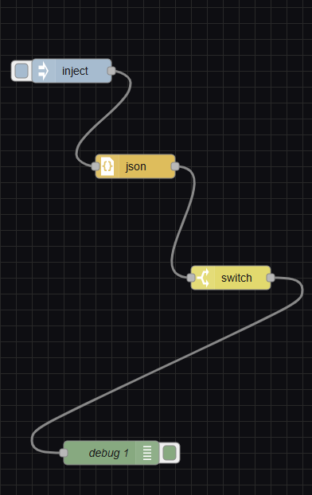

# Agri-Logistix Tracker

## Project Overview

Agri-Logistix Tracker is an IoT prototype for monitoring the transport conditions of perishable agricultural products. The project focuses on tracking cargo location and monitoring temperature, humidity, door status, and tracker battery level.

The prototype work demonstrated by the team uses a **Node-RED dashboard and flow** for monitoring and alert presentation. The repository also contains Python/ROS 2 tracker code as a development scaffold; the presence of that code does not mean a Gazebo simulation or physical GPS deployment was completed.

## Team

- Anesu Mugweni
- NUST Email: n02530952v@students.nust.ac.zw
- Ezra Kufazvineyi
- NUST Email: n02531364l@students.nust.ac.zw
- Tonderai Tevera
- NUST Email: n02530022R@students.nust.ac.zw
- Rasheed Phiri
- NUST Email: N02530037H@students.nust.ac.zw
- Anotida Chimhandamba
- NUST Email: n02529595c@students.nust.ac.zw
- Malvin Borerwe
- NUST Email: n02528964h@students.nust.ac.zw

## Prototype Monitoring

The Node-RED dashboard is used to present monitoring information and alerts for the prototype.

The intended monitoring parameters and alert thresholds are:

| Parameter | Intended safe range / condition | Alert condition |
|---|---|---|
| Cargo temperature | 5–12 °C | Below 5 °C or above 12 °C |
| Cargo humidity | 60–90% | Below 60% or above 90% |
| Door status | Closed during transit | Door opens during transit |
| Tracker battery | Above 20% | Below 20% |

The Node-RED flow is responsible for presenting the prototype's monitoring and alert information. Alert history is available through the dashboard flow as configured for the demonstration.

## Repository Contents

- `agri_tracker/`: Python ROS 2 package code, including tracker and alert node files.
- `resource/`: ROS 2 package resource marker.
- `test/`: Existing package quality checks.
- `package.xml` and `setup.py`: ROS 2 package metadata and setup.
- `docs/screenshots/`: Project dashboard screenshot.

**Implementation note:** The Python/ROS 2 files are retained in the repository as supporting development work. The team demonstration focused on Node-RED. Gazebo simulation and physical GPS hardware should not be treated as completed features.

## Limitations & Future Work

The current system is a prototype. The following limitations and improvements have been identified:

1. **Simulation and environment:** Gazebo simulation was not part of the team's demonstrated implementation. The project demonstration used Node-RED. Any future Gazebo work should include verified setup instructions and correct world-file paths before being documented as operational.
2. **Real GPS integration:** The current location approach does not establish real-world GPS latitude and longitude from a physical receiver. Future work includes integrating a NEO-6M GPS module to provide actual latitude/longitude coordinates.
3. **Battery modelling:** The current battery simulation is a placeholder and does not represent measured hardware power consumption. Future iterations should calculate battery usage using realistic power-consumption measurements or a documented battery model.
4. **Alert handling and history:** The Node-RED flow is used to trigger and display prototype alerts. Future work should strengthen alert handling with timestamps, persistent event history, duplicate-alert suppression, and recovery notifications when readings return to safe ranges.
5. **Testing:** Testing for the prototype was performed manually by checking outputs in the terminal and on the Node-RED dashboard. Automated functional tests should be added in future iterations to verify sensor thresholds, alert conditions, invalid readings, and end-to-end data flow.

## Future Development

Further development could include:

- Connecting a physical NEO-6M GPS module and environmental sensors.
- Replacing placeholder battery values with measured power data.
- Improving alert history, notification handling, and fault detection.
- Adding automated tests for the monitoring and alert logic.
- Validating the complete system with physical hardware before deployment.

## Acknowledgement of Prototype Scope

The current deliverable demonstrates a prototype monitoring workflow. It should not be represented as a fully deployed logistics tracker or as a completed physical GPS/Gazebo system. The limitations above describe work required for a more reliable future version.
